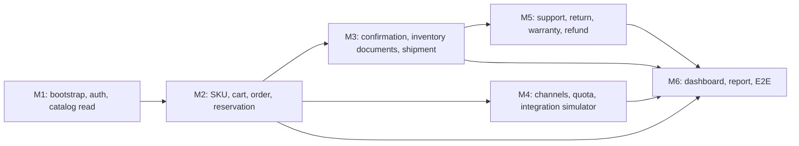

# Sitemap 40 màn hình nghiệp vụ

Trạng thái: `PLANNED` — quyết định điều hướng cho backlog UI. Danh mục này đếm **40 màn hình nghiệp vụ**: 13 màn hình khách hàng và 27 màn hình nội bộ. `403` và `404` là màn hình kỹ thuật dùng chung, nằm ngoài số đếm. Modal, drawer, tab, phân trang và các trạng thái loading/empty/error không tạo thêm màn hình.

## Căn cứ và phạm vi

- Nguồn đã đọc: `README.md`, `AGENTS.md`, `docs/source/` (hiện chỉ có `.gitkeep`), `docs/backlog.md`, `docs/architecture/decision-register-task-004.md`, `docs/adr/ADR-003-local-demo-scope.md`, API và frontend hiện có.
- API thật duy nhất hiện có là `GET /api/products`; contract được mô tả tại `docs/api/catalog.md`. Tất cả API khác trong bảng là contract cần chốt trước khi FE triển khai và có trạng thái `PLANNED`.
- `C01` hiện đang có route `/`, nhưng là landing “About us” tĩnh của Công ty A. Nó không đáp ứng nội dung trang chủ thương mại (danh mục, sản phẩm nổi bật, tìm kiếm, điều hướng mua hàng), nên không được tính `IMPLEMENTED` và phải thay thế theo slice M1/M2 bằng dữ liệu API thật.
- Layout và route guard của FE chưa được triển khai. Kiểm tra quyền/ownership phải do BE thực thi; route guard chỉ cải thiện trải nghiệm.

## Layout, route dùng chung và quyền

| Thành phần | Áp dụng | Trách nhiệm |
| --- | --- | --- |
| `CustomerLayout` | C01–C13 | Header, tìm kiếm, điều hướng, giỏ hàng, footer; hiển thị theo trạng thái đăng nhập. |
| `AdminLayout` | A01–A27 | Sidebar theo quyền, header, breadcrumb, vùng nội dung; mỗi hành động gọi API có kiểm tra quyền. |
| `/login` | C07 dùng chung cho Customer và nhân viên | Không tạo màn hình đăng nhập quản trị riêng. Sau đăng nhập BE trả quyền để điều hướng phù hợp. |
| `/403` | dùng chung | Từ chối quyền sau khi BE trả `403`; không tính vào 40 màn hình. |
| `/404` | dùng chung | Không tìm thấy route/tài nguyên; không tính vào 40 màn hình. |

## Sitemap khách hàng — 13 màn hình

| ID | Route | Layout / role gate | Module và API hiện trạng | Mốc, phụ thuộc |
| --- | --- | --- | --- | --- |
| C01 | `/` | CustomerLayout; public | Catalog; `GET /api/products` có thật nhưng chưa đáp ứng featured/category/search | M1–M2; Catalog contract, seed |
| C02 | `/products` | CustomerLayout; public | Catalog; mở rộng API danh sách với query search/category/price/sort/page | M1–M2; C01, catalog query contract |
| C03 | `/products/:slug` | CustomerLayout; public | Catalog; product detail/SKU API planned, không trả P/Q/B/R/A/U | M2; SKU, public catalog policy |
| C04 | `/cart` | CustomerLayout; guest/customer | Cart; cart API planned hoặc client cart chuyển hóa tại checkout | M2; C03, pricing contract |
| C05 | `/checkout` | CustomerLayout; customer | Order/Payment/Shipment options; create-order API planned, BE tính giá và giữ tồn | M2; C04, auth, inventory reservation |
| C06 | `/checkout/result/:orderId` | CustomerLayout; customer ownership | Order/Payment; order-result API planned, không suy ra paid từ tạo đơn | M2; C05, order/payment states |
| C07 | `/login` | CustomerLayout tối giản; public | Auth API planned | M1; ADR-002 auth, identity seed |
| C08 | `/register` | CustomerLayout tối giản; public | Identity API planned | M1; validation, identity policy |
| C09 | `/account` | CustomerLayout; customer ownership | Customer/profile/address APIs planned; address form là modal/drawer | M1–M2; C07, identity |
| C10 | `/account/orders` | CustomerLayout; customer ownership | Order query API planned | M2; C05, pagination/filter contract |
| C11 | `/account/orders/:id` | CustomerLayout; customer ownership | Order/Payment/Shipment history API planned; conditionally expose cancel/after-sales | M2–M3; C10, state table |
| C12 | `/account/requests` | CustomerLayout; customer ownership | Support/Return/Warranty query/create APIs planned; creation is modal/drawer | M5; C11, after-sales policy |
| C13 | `/account/requests/:id` | CustomerLayout; customer ownership | Support/Return/Warranty detail API planned; type-specific rendering | M5; C12, request state tables |

## Sitemap quản trị nội bộ — 27 màn hình

| ID | Route | Layout / role gate | Module và API hiện trạng | Mốc, phụ thuộc |
| --- | --- | --- | --- | --- |
| A01 | `/admin` | AdminLayout; authorized employee | Dashboard aggregate/query APIs planned; every metric needs definition and source | M6; data from M2–M5 |
| A02 | `/admin/products` | AdminLayout; Catalog read permission | Catalog admin list API planned | M1–M2; auth/permission, catalog |
| A03 | `/admin/products/:id`, `/admin/products/new` | AdminLayout; Catalog create/update permission | Catalog detail/create/update APIs planned; one screen for new/edit | M2; A02, SKU/price policy |
| A04 | `/admin/categories` | AdminLayout; Catalog manage permission | Category list/mutation APIs planned; mutation is modal | M2; A02, category schema |
| A05 | `/admin/orders` | AdminLayout; Order read permission | Order query API planned with channel/status/time/assignee filters | M2; auth, order schema |
| A06 | `/admin/orders/:id` | AdminLayout; Order action permission | Order command/detail APIs planned; valid state actions only | M2–M3; A05, state table, reservation |
| A07 | `/admin/customers` | AdminLayout; Customer read/manage permission | Customer query/mutation APIs planned; mutation is modal | M1–M2; auth, identity |
| A08 | `/admin/customers/:id` | AdminLayout; Customer read permission | Customer profile/order/request APIs planned, scoped by staff permission | M2–M5; A07, ownership/audit policy |
| A09 | `/admin/inventory` | AdminLayout; Inventory read permission | Inventory balance API planned showing P/Q/B/R/A/U with definitions | M2; inventory model, warehouse/SKU |
| A10 | `/admin/inventory/documents` | AdminLayout; Inventory document read permission | Inventory-document list API planned | M3; inventory ledger |
| A11 | `/admin/inventory/documents/:id`, `/admin/inventory/documents/new` | AdminLayout; document create/confirm permission | Document detail/command APIs planned; one screen for new/detail | M3; A10, order linkage and approval |
| A12 | `/admin/inventory/reservations` | AdminLayout; Inventory read permission | Reservation and movement-history APIs planned; tabs are one screen | M2–M3; reservation ledger |
| A13 | `/admin/channels` | AdminLayout; Channel manage permission | Channel/quota/sync APIs planned; configuration drawer | M4; inventory A/quota, integration adapter |
| A14 | `/admin/integrations` | AdminLayout; Integration read/retry permission | Inbox/outbox/sync exception APIs planned; masked payload drawer | M4; A13, idempotency, audit |
| A15 | `/admin/shipments` | AdminLayout; Shipment read permission | Shipment list API planned | M3; order fulfillment |
| A16 | `/admin/shipments/:id` | AdminLayout; Shipment action permission | Shipment detail/event/exception APIs planned | M3; A15, simulated carrier adapter |
| A17 | `/admin/returns` | AdminLayout; Return read permission | Return list API planned | M5; order line shipment history |
| A18 | `/admin/returns/:id` | AdminLayout; Return action permission | RMA/QC/refund/inventory command APIs planned | M5; A17, return state, P/Q policy |
| A19 | `/admin/warranties` | AdminLayout; Warranty read permission | Warranty list API planned | M5; catalog warranty policy |
| A20 | `/admin/warranties/:id` | AdminLayout; Warranty action permission | Warranty detail/command APIs planned | M5; A19, warranty state |
| A21 | `/admin/support` | AdminLayout; Support read permission | Ticket list API planned | M5; support assignment policy |
| A22 | `/admin/support/:id` | AdminLayout; Support action permission | Ticket conversation/internal-note/action APIs planned; no internal note in customer API | M5; A21, audit/visibility rules |
| A23 | `/admin/payments` | AdminLayout; Payment/refund permission | Payment/refund/reconciliation APIs planned; tabs and detail drawer one screen | M3–M5; payment states, refund cap/idempotency |
| A24 | `/admin/reports` | AdminLayout; Report read permission | SQL demo aggregate/query APIs planned; tabs one screen | M6; metric definitions, M2–M5 data |
| A25 | `/admin/users` | AdminLayout; Admin manage-user permission | Employee/role/matrix APIs planned; mutation modal | M1; auth/RBAC contract |
| A26 | `/admin/settings` | AdminLayout; configuration/audit permissions separated per tab/API | Demo-config and audit APIs planned; secrets never returned | M1–M6; ADR-003, audit/RBAC |
| A27 | `/admin/simulator` | AdminLayout; permitted demo/dev role only | Simulator scenario/result APIs planned; never enabled outside demo/dev | M4; simulated adapters, inbox/outbox |

## Dependency order

The first complete UI slice is `C02 → C03 → C04 → C05 → C06 → A05 → A06 → A11 → A15 → A16`. It may only move to `IMPLEMENTED` once its screens call the corresponding real FE–BE–SQL Server flow. Until then, no placeholder navigation or hard-coded data is evidence of completion.

## Assumptions and blockers

1. `docs/source/` contains no KTHT report, ERD or BPMN file in this workspace; statuses and API/module mappings remain provisional where the source does not confirm them.
2. Application role gates use the roles enumerated in `README.md` (Customer, Sales, Warehouse, CustomerService, Manager, Admin). Exact permission matrix and auth response contract must be finalized in M1 under ADR-002.
3. “Pharmacist consultation” is not a named application role in `README.md`; any review action needed for regulated products must be assigned to a permission in the M1/M2 matrix before API implementation.
4. No extra screens were added. Detail drawers, modals, tabs and technical 403/404 are explicitly outside the 40-screen count.
