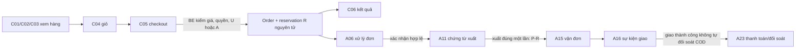

# Luồng người dùng và nghiệp vụ cho 40 màn hình

**Trạng thái:** PLANNED — tài liệu BA cho Bước 2; không xác nhận rằng API hoặc màn hình đã tồn tại.  
**Owner:** BA. **Reviewer bắt buộc:** DR (nghiệp vụ), SA (route/contract), BE (ủy quyền và state transition), FE (khả thi UI), QA (oracle kiểm thử).  
**Nguồn:** yêu cầu sitemap 40 màn hình; `README.md` §§2–5; `AGENTS.md` §§4, 7–10; `docs/architecture/process-register.md`; `docs/architecture/inventory-model.md`; `docs/architecture/decision-register-task-004.md`; `docs/business-rules.md`; `docs/api/catalog.md`. `docs/source/` hiện chỉ có `.gitkeep`; các quyết định TASK-004 dẫn chiếu báo cáo KTHT ngoài repository.

## Quy ước và contract hiện trạng

- Hai layout là `CustomerLayout` cho C01–C13 và `AdminLayout` cho A01–A27. `/login` dùng chung; BE xác minh danh tính, quyền hành động và quyền sở hữu đối tượng, còn FE chỉ điều hướng/ẩn hành động không phù hợp.
- Mỗi dòng bên dưới nêu **module/API** theo dạng `E` (đang tồn tại) hoặc `P` (planned), không được thay bằng mock để nhận nghiệm thu. API tồn tại duy nhất đã xác minh là `E Catalog: GET /api/products`; nó chưa có search/filter/category/slug chi tiết.
- `403` và `404` là màn hình kỹ thuật dùng chung, không nằm trong 40 dòng. Loading, empty, error, validation, pagination, tab, modal và drawer là trạng thái/component của màn hình chủ, không tạo route mới.
- Các API P phải dùng lỗi validation, `401/403`, `404`, `409` và idempotency ở mutation cần thiết. Tên endpoint/bảng là đề xuất contract, phải được SA+BE chốt trước khi implementation.
- Invariant dùng xuyên các flow: `U = P − Q − B − R − A` tại SKU–lô–kho; `R` là reservation đơn, `A` là quota campaign/kênh. Không được lộ P/Q/B/R/A/U hay quota cho khách. Tạo order+R là transaction; shipment/payment/return có lifecycle riêng; event trùng/trễ không tạo order, tồn hoặc tiền trùng.

## Luồng dọc ưu tiên M2–M3: mua đến giao hàng

Các nhánh chặn: thiếu U/A, SKU không hoạt động, giá thay đổi, khóa trùng idempotency, hoặc quyền sai trả kết quả rõ ràng và không tạo một phần order/reservation. Hủy dòng chưa xuất đi qua C11/A06 rồi giải phóng R theo nguồn quota; hủy cạnh tranh xuất chỉ một transition thắng. Risk review/dược sĩ sau reservation giữ R 24 giờ, chỉ gia hạn một lần tối đa 24 giờ có lý do; hết hạn/từ chối giải phóng theo policy, duyệt muộn phải re-check rồi giữ lại.

## Website khách hàng — 13 màn hình

| ID / route | Actor, mục tiêu và chuyển tiếp | Module / API / dữ liệu | Ràng buộc, trạng thái UI, dependency | Owner / reviewer |
| --- | --- | --- | --- | --- |
| C01 `/` | Anonymous/Customer tìm hàng; đi C02 theo tìm kiếm/danh mục, C03 theo sản phẩm, C04 theo giỏ. | `E Catalog GET /api/products` cho featured tạm thời; `P Catalog` curated/category. Product, SKU, Category. | Không khẳng định featured khi API chưa có; loading/empty/error; không route About us ngoài sitemap. Dep: M1 catalog. | FE / BA, QA |
| C02 `/products` | Anonymous/Customer tìm, lọc danh mục/giá, sắp xếp, phân trang rồi mở C03. | `E GET /api/products` chỉ phân trang; `P Catalog search/filter/sort`. Product, SKU, Category. | Query parameter không tạo trang mới; chỉ hàng công khai; dữ liệu filter từ BE. Dep: M1. | FE+BE / QA, BA |
| C03 `/products/:slug` | Anonymous/Customer xem SKU/biến thể, chọn lượng, thêm C04. | `P GET /api/products/{slug}`, cart mutation. Product/SKU/price history. | Không lộ tồn/quota nội bộ; validate SKU active và lượng dương ở BE khi checkout. Dep: C02 contract. | FE+BE / BA, QA |
| C04 `/cart` | Customer/guest quản lý SKU, lượng, xóa; hợp lệ thì tới C05. | `P Cart` (session/customer) API. Cart, CartItem. | Giỏ không tạo R; giá chỉ là estimate, loading/empty/error, quantity validation. Dep: C03. | FE+BE / DR, QA |
| C05 `/checkout` | Customer chọn địa chỉ/giao/pay, xác nhận để C06. | `P Orders POST /orders` idempotent; address/payment-method/shipping method. Order, Item, Reservation. | BE tính lại giá/khả dụng và tạo toàn bộ order+R hoặc rollback; payment success không bypass review. Dep: M2 order/inventory/auth. | FE+BE+DB / DR, QA, SEC |
| C06 `/checkout/result/:orderId` | Customer xem kết quả tạo đơn, payment status, bước sau; liên kết C11. | `P GET /orders/{id}` ownership. Order, Payment. | Chỉ chủ đơn; tạo đơn ≠ paid; 404/403 riêng; không retry POST bằng refresh. Dep: C05/auth. | FE+BE / QA, SEC |
| C07 `/login` | Anonymous đăng nhập, trở về route hợp lệ hoặc C01; Admin cũng dùng route này. | `P Auth login/logout/session`. User, Role, session. | Validation/lỗi xác thực; redirect không được vượt role; auth mechanism chờ ADR-002 chốt. Dep: M1 auth. | FE+BE / SEC, QA |
| C08 `/register` | Anonymous tạo Customer và chuyển C07/C01. | `P Auth register`. User, Customer, audit. | Validate server-side, unique identity, không cho tự chọn quyền; loading/error/success. Dep: M1 auth. | FE+BE / SEC, QA |
| C09 `/account` | Customer sửa profile, xem/quản lý address bằng modal/drawer. | `P Account/Profile/Addresses`. Customer, Address. | Ownership BE; address validation; modal không là screen; không đổi quyền. Dep: auth. | FE+BE / QA, SEC |
| C10 `/account/orders` | Customer tìm/lọc/phân trang đơn của mình rồi C11. | `P GET /me/orders`. Order, Item, Payment, Shipment summary. | Ownership/pagination ở BE; empty/error/filter status. Dep: M2 auth/order. | FE+BE / QA, SEC |
| C11 `/account/orders/:id` | Customer xem chi tiết/lịch sử; hủy dòng đủ điều kiện hoặc mở C12. | `P GET /me/orders/{id}`, `POST .../cancellations`. Order/Item/R/Payment/Shipment/audit. | Chỉ chưa xuất được hủy; action state-gated, R release một lần; chuyển C12 cho aftersales. Dep: M2–M3. | FE+BE / DR, QA, SEC |
| C12 `/account/requests` | Customer xem ticket/return/warranty theo tab, tạo request bằng drawer rồi C13. | `P GET/POST /me/requests`, return/warranty/support modules. Request, Return, Warranty, Ticket. | Tạo phải liên kết order-item đủ điều kiện; tabs không là pages; no internal note. Dep: M5/auth. | FE+BE / DR, QA |
| C13 `/account/requests/:id` | Customer xem trao đổi/lịch sử/kết quả; response theo loại request. | `P GET /me/requests/{id}`, customer message command. Request/Message/Return/Warranty. | Ownership; không đồng nhất ticket/return/warranty; không hiển thị ghi chú nội bộ; no stock change merely by request. Dep: M5. | FE+BE / DR, SEC, QA |

## Quản trị nội bộ — 27 màn hình

| ID / route | Actor, mục tiêu và chuyển tiếp | Module / API / dữ liệu | Ràng buộc, trạng thái UI, dependency | Owner / reviewer |
| --- | --- | --- | --- | --- |
| A01 `/admin` | Staff theo quyền xem KPI, cảnh báo rồi đi A05/A09/A14. | `P Dashboard read model`. Orders, inventory, integration/audit aggregates. | Mỗi KPI ghi definition + source/time window; data source local demo; 403. Dep: M6/read models. | FE+BE / BA, QA |
| A02 `/admin/products` | Catalog staff tìm/lọc sản phẩm, sang A03. | `P Admin Catalog list`. Product/SKU/Category. | Action-based permission, pagination; dep M1. | FE+BE / QA, SEC |
| A03 `/admin/products/:id`, `/admin/products/new` | Catalog staff tạo/sửa product, SKU, giá, trạng thái; về A02. | `P Admin Catalog commands`. Product/SKU/Price/audit. | Same screen two routes; server validation/audit; published rules; dep M1. | FE+BE / BA, QA |
| A04 `/admin/categories` | Catalog staff xem cấu trúc, thêm/sửa modal. | `P Categories`. Category. | Không tạo route modal; prevent invalid tree; dep M1. | FE+BE / BA, QA |
| A05 `/admin/orders` | Sales/Manager lọc kênh/trạng thái/time/assignee rồi A06. | `P Admin Orders query`. Order summaries. | Permission object scope; pagination/loading/error; dep M2. | FE+BE / QA, SEC |
| A06 `/admin/orders/:id` | Sales xử lý action hợp lệ; đi A11/A15/A23/A18 theo state. | `P Order workflow commands/read`. Order/Item/R/Payment/Shipment/audit. | No arbitrary status dropdown; conditional transition, partial cancel line-based, idempotent; dep M2–M3. | FE+BE+DB / DR, QA, SEC |
| A07 `/admin/customers` | Authorized staff tìm/lọc, modal create/edit nếu quyền, sang A08. | `P Customers`. Customer/User. | Không mặc định mọi role được create/edit; PII minimization/audit; dep auth. | FE+BE / SEC, QA |
| A08 `/admin/customers/:id` | Authorized staff xem profile/orders/requests allowed. | `P Customer 360 read`. Customer/order/request. | Scope + sensitive field permission at BE; dep M2/M5. | FE+BE / SEC, QA |
| A09 `/admin/inventory` | Warehouse/Manager xem SKU–kho, mở A10/A12/A13. | `P Inventory read`. Inventory balance, lot, warehouse, allocation. | Explain P,Q,B,R,A,U; U formula source-of-truth SQL; no direct mutation; dep M2. | FE+BE+DB / DR, QA |
| A10 `/admin/inventory/documents` | Warehouse lọc phiếu nhập/xuất/adjustment, đi A11. | `P Inventory document list`. InventoryDocument. | status/role filters; no manual independent issue for order shipment; dep M3. | FE+BE / DB, QA |
| A11 `/admin/inventory/documents/:id`, `/new` | Warehouse tạo/xem/xác nhận chứng từ hợp lệ, về A10/A06. | `P Inventory document commands`. Document/line/audit. | Same screen; source/reason/confirm role; order-linked issue cannot double reduce P; dep M3. | FE+BE+DB / DR, QA |
| A12 `/admin/inventory/reservations` | Sales/Warehouse xem tabs R và movements, đi A06/A11. | `P Reservation/movement query`. Reservation, ledger. | Read-only R quantity; no bypass via direct edit; links to source record. Dep M2. | FE+BE / DR, QA |
| A13 `/admin/channels` | Channel Manager config channel/SKU quota in drawer, request/reconcile transfer. | `P Channel allocation`. Channel, Allocation, sync history. | A locked at SKU–lot–warehouse; decrease confirmation before increase; timeout not release. Dep M4. | FE+BE+DB / DR, QA |
| A14 `/admin/integrations` | Integration staff inspect duplicate/error/retry/reconciliation; masked payload drawer. | `P Inbox/outbox/sync`. IntegrationEvent, Inbox, Outbox. | Safe retry/idempotent, no duplicate order/R; sensitive redaction; dep M4. | FE+BE / DR, SEC, QA |
| A15 `/admin/shipments` | Logistics staff filter shipments and go A16. | `P Shipment list`. Shipment/Order. | Delivery status not payment settled; dep M3. | FE+BE / QA, DR |
| A16 `/admin/shipments/:id` | Logistics view events and resolve exception; links A06/A23. | `P Shipment workflow`. Shipment, event history. | Ordered/versioned event handling; no state rollback; COD separate. Dep M3–M4. | FE+BE / DR, QA |
| A17 `/admin/returns` | CS/Warehouse list return requests, go A18. | `P Return list`. Return/RMA. | Filter by state/assignee; no stock change by request. Dep M5. | FE+BE / DR, QA |
| A18 `/admin/returns/:id` | CS/Warehouse assess, receive, QC, classify, trigger money/hàng action. | `P Return workflow/refund intent`. Return/item/QC/refund/inventory doc. | Partial line caps; reception P+Q, pass QC reduces Q only; warranty separate. Dep M5. | FE+BE+DB / DR, QA |
| A19 `/admin/warranties` | CS list warranty cases and go A20. | `P Warranty list`. WarrantyCase. | Eligibility/status filters; dep M5. | FE+BE / QA, DR |
| A20 `/admin/warranties/:id` | CS assess/record outcome/history. | `P Warranty workflow`. WarrantyCase/audit. | Warranty does not imply exchange/refund/restock; state-gated. Dep M5. | FE+BE / DR, QA |
| A21 `/admin/support` | CS filter/assign/priority/search ticket then A22. | `P Support list`. Ticket. | Only roles with scope see tickets; dep M5. | FE+BE / SEC, QA |
| A22 `/admin/support/:id` | CS communicates, adds internal note, assigns, links order, records history. | `P Support workflow/messages`. Ticket/Message/audit. | Internal note never exposed via C12/C13 API; permission/action audit. Dep M5. | FE+BE / SEC, QA |
| A23 `/admin/payments` | Finance/Manager view payment/refund/reconciliation tabs and drawer detail. | `P Payments/refunds/reconciliation`. Payment, Refund, Reconciliation. | Explicit simulated/pending/success/failed; prevent duplicate/excess refund; delivery ≠ COD reconciliation. Dep M3/M5. | FE+BE+DB / DR, QA, SEC |
| A24 `/admin/reports` | Manager views revenue/order/inventory/channel/aftersales tabs with filters. | `P Reporting query/view`. Audit-safe read models. | Metric definition/source/timezone visible; no mixed snapshot; dep M6. | FE+BE / BA, QA |
| A25 `/admin/users` | Admin maintains staff/accounts/roles/matrix via modal. | `P Identity admin`. User, Role, permission, audit. | BE protects role assignment; no self-escalation; dep M1 auth. | FE+BE / SEC, QA |
| A26 `/admin/settings` | Admin/authorized roles manage demo config or audit tab. | `P Demo settings/audit query`. Setting, AuditLog. | Separate tab/API permission; hide secrets; env-only secrets; dep M1+M6. | FE+BE / SEC, QA |
| A27 `/admin/simulator` | Authorized demo staff selects scenario, sends simulated event, reads expected/actual and record link. | `P Dev-only simulator`. Scenario, Inbox/Outbox, SyncHistory. | Demo/dev only + role; duplicate/delay/out-of-order safe; no production route/secret. Dep M4, ADR-003. | FE+BE / DR, SEC, QA |

## Liên thông hậu mãi, quota và quyền

1. **Hậu mãi:** C11/C12 chọn đúng order item → A17/A18 hoặc A19/A20 hoặc A21/A22 theo loại. Return được chấp nhận theo lượng đã giao còn điều kiện; hàng nhận về vào `P+Q`, chỉ QC pass giảm `Q`. Warranty không tự cộng tồn; ticket nội bộ không đi lại C13.
2. **Kênh:** A13 tạo/thay đổi allocation `A`, A14 nhận event có inbox/version/order, A06 hiển thị reservation đã chuyển `A→R`; hủy/expiry trả `R→A` khi quota còn hiệu lực. Chỉ reconciliation xác nhận mới release A về U.
3. **Quyền:** Customer routes chỉ đọc/mutate tài nguyên chủ thể; route admin không đủ để cấp quyền. A06/A11/A13/A18/A23/A25/A27 phải kiểm tra action và state ở BE; UI render `Forbidden` khi biết không có permission, API vẫn là authority.

## Assumptions, dependency và điểm DR cần phản biện

| ID | Giả định / ảnh hưởng | Dependency / quyết định cần chốt | DR review cần phản ví dụ |
| --- | --- | --- | --- |
| AS-UI-01 | Auth dùng `/login` chung, role sau login quyết định home/return route. | ADR-002, M1 identity/CSRF/session. | Redirect sang admin khi customer, object IDOR. |
| AS-UI-02 | Tạo đơn giữ R trước risk/pharmacist review theo TTL TASK-004; không giữ giỏ. | M2 state table, inventory SQL concurrency. | Expiry/hủy đồng thời xuất; duyệt sau expiry; payment trước review. |
| AS-UI-03 | Partial cancel/return theo order-item được hỗ trợ; partial shipment chỉ M3 khi đủ source lực. | M2 item/R model; M3 shipment; M5 RMA/QC/refund. | Một dòng đã xuất một phần, vượt lượng/tiền, nhiều shipment. |
| AS-UI-04 | Quota campaign/kênh là A ở SKU–lô–kho; transfer/release cần xác nhận. | M4 adapter/inbox/outbox/reconciliation. | Retry webhook, quota hết hạn có R, timeout thu hồi. |
| AS-UI-05 | Dược sĩ/risk review là action/work queue nằm A06, không thêm trang thứ 41. | Chưa chốt role/matrix, state table nguồn KTHT. | Ai quyết định, điều kiện reject/extend, audit/legal record. |
| AS-UI-06 | Dashboard/report dùng SQL read model local, mô phỏng rõ. | ADR-003; M6 data definitions. | KPI không nhất quán với order/inventory, dữ liệu stale. |

## Tiêu chí chấp nhận Bước 2

- Mỗi ID C01–C13 và A01–A27 xuất hiện đúng một lần trong tài liệu này; không có thêm màn hình nghiệp vụ.
- SA+BE xác nhận endpoint/mutation P trước khi FE làm giao diện; API thật thay mock trước `VERIFIED`.
- DR xác nhận các gate tồn kho, partial, return QC, quota và payment/shipment; QA chuyển các nhánh chặn thành test contract/E2E.
- Sự khác nhau giữa nguồn KTHT ngoài repo, quyết định TASK-004 và tài liệu provisional cũ phải được ghi finding/ADR, không tự chọn theo code.
